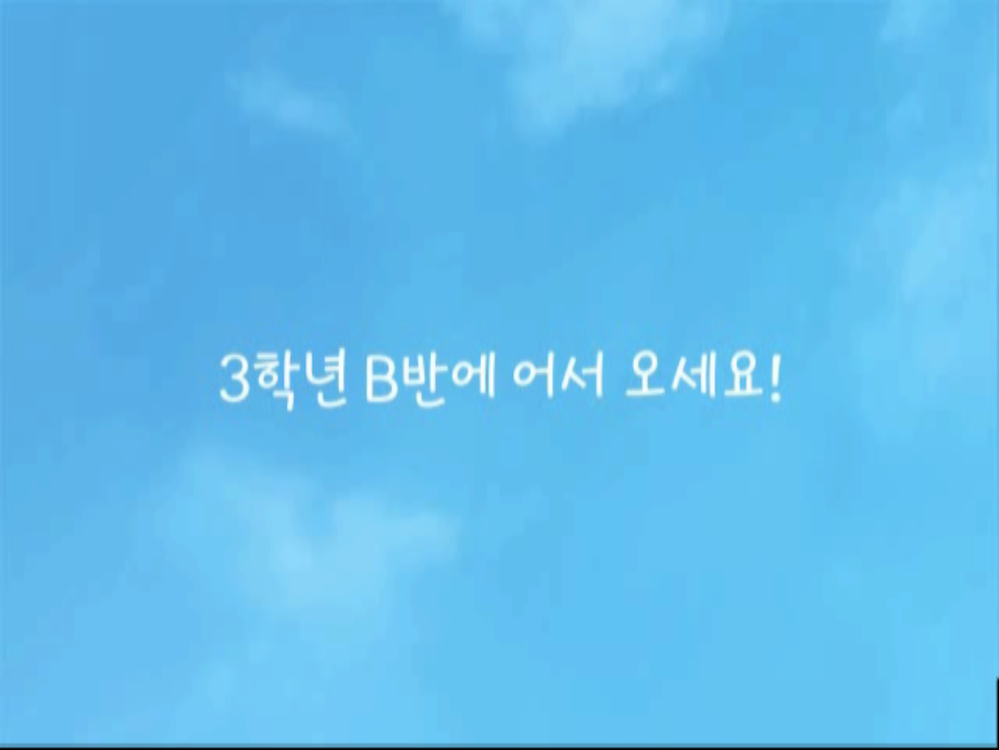
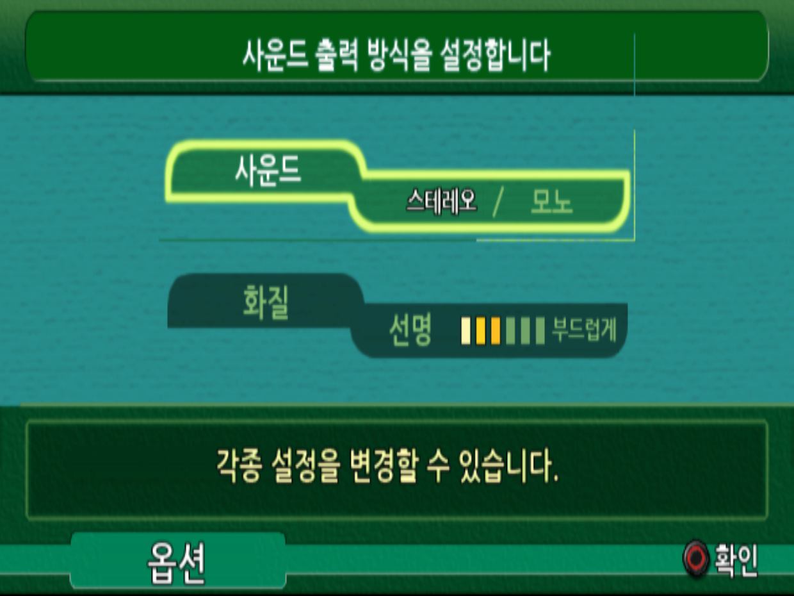

# 킨파치 선생님 PS2 한국어 패치 v267 · 적용기 r2

『3年B組金八先生 伝説の教壇に立て！ 完全版』 일본판의 한국어 패치입니다. 한국어 대사·기록문·메뉴·그래픽과 학생 문자 영상을 적용하고, 두 줄 자막의 분할·읽기 호흡·가독성을 다듬었습니다.

**[간편 설치 ZIP 받기](https://github.com/ayaneros-eng/kinpachi-ps2-korean-patch/releases/download/v267-r2/Kinpachi_KR_v267_r2_Windows.zip)** · [릴리스 설명](https://github.com/ayaneros-eng/kinpachi-ps2-korean-patch/releases/tag/v267-r2) · [배포 범위](LEGAL_SCOPE_KO.txt)

직접 준비한 **일본판 완전판 원본 ISO**를 읽어 별도의 한국어 ISO를 만듭니다. 게임과 BIOS는 제공하지 않으며, 원본 ISO는 변경하지 않습니다.

> **패치 도중 오류가 났다면 적용기 r2로 다시 받아 주세요.** Python을 직접 설치하거나 버전을 바꿀 필요가 없습니다. 이미 정상 완성된 v267 ISO는 그대로 사용하세요.

> **PCSX2에서 얼굴에 세로줄이 보이나요?** [세로줄 주의사항과 설정 방법](#pcsx2-세로줄-주의사항)을 먼저 확인해 주세요.

## 필요한 원본 ROM

아래 원본만 지원합니다. 파일 이름보다 **크기와 SHA-256**이 중요합니다.

| 항목 | 필요한 값 |
| --- | --- |
| 게임 | 3年B組金八先生 伝説の教壇に立て！ 完全版 |
| 기종·지역 | PlayStation 2 / 일본판 |
| 제품 번호 | **SLPM-66089** |
| 디스크 안 실행 파일 | `SLPM_660.89` |
| 원본 ISO 크기 | **4,680,515,584바이트** |
| 원본 SHA-256 | `4eb6db476d86bf1ea22f0e75d1412150fd8af716302c86d180b9a9fe5c209fb4` |

일반판, 다른 지역판, 이미 한국어 패치를 적용한 ISO는 입력으로 사용할 수 없습니다. 원본 검사가 실패하면 강제로 적용하지 말고 판본과 파일을 확인하세요. ROM 다운로드 링크는 제공하지 않습니다.

## 설치 준비

- Windows x64 PC(Intel/AMD 64비트)가 필요합니다. **Python 사전 설치는 필요 없습니다.** 설치된 Python·Anaconda·Microsoft Store Python을 사용하지 않고 검증된 전용 환경을 자동으로 준비합니다.
- 처음에는 전용 실행 환경과 의존성을 설치할 인터넷 연결이 필요합니다.
- **결과를 저장할 드라이브에 10 GiB 이상의 여유 공간**이 필요합니다. 원본 ISO 외에 새 ISO와 임시 작업 파일이 별도로 생깁니다.
- ZIP을 먼저 압축 해제하세요. 압축 파일 안에서 직접 실행하지 마세요.

## 간편하게 적용하기

패치 파일은 [Releases의 **Kinpachi_KR_v267_r2_Windows.zip**](https://github.com/ayaneros-eng/kinpachi-ps2-korean-patch/releases/download/v267-r2/Kinpachi_KR_v267_r2_Windows.zip)입니다. 저장소의 소스 다운로드(`Code → Download ZIP`)에는 실행 패치가 포함되지 않습니다.

1. **Kinpachi_KR_v267_r2_Windows.zip**을 받아 새 폴더에 압축 해제합니다.
2. **`한글패치_만들기.cmd`를 더블클릭**합니다.
3. 원본 ISO를 선택하고, 완성 파일을 저장할 폴더를 선택합니다.
4. 요약 창에서 전용 실행 환경 준비와 패치 생성을 확인합니다. 처음에는 공식 Python과 필수 구성요소를 내려받습니다(약 80MB).
5. 저장 위치 안에 새로 만들어진 `Kinpachi-v267-r2-날짜-식별자` 폴더에서 완성 ISO와 결과 보고서를 확인합니다.

전용 환경은 선택한 저장 폴더의 `KinpachiRuntime-r2` 안에 만듭니다. CPython 공식 NuGet **3.12.10 x64**와 해시로 고정한 NumPy·Pillow·PyAV를 사용하며, Windows에 설치하거나 PATH를 바꾸지 않습니다. Python 원본의 SHA-256·공식 SHA-512 및 PSF 서명도 확인합니다. 다음 실행에서는 정상 환경을 검사해 재사용하고, 손상되거나 불완전한 환경은 새로 준비합니다. [Python 공식 배포 안내](https://docs.python.org/3.12/using/windows.html#the-nuget-org-packages)

실행기는 원본 ISO를 덮어쓰지 않습니다. 전용 실행 환경·작업 파일·로그는 별도 경로에 만듭니다. 하위 `patch` 폴더는 검증 대상이므로 파일을 넣거나 편집하지 마세요.

영상·그래픽을 원본에서 생성하므로 시간이 걸릴 수 있습니다. 진행 메시지가 잠시 없어도 영상 처리 중일 수 있습니다. 실패했다면 결과 폴더의 로그를 확인하고, `.partial` 파일은 게임 실행에 사용하지 마세요.

## 적용 중 오류가 났을 때

- **Python을 따로 설치·삭제하거나 버전을 바꾸지 마세요.** 최신 ZIP을 새 폴더에 압축 해제하고 `한글패치_만들기.cmd`로 실행하세요. 구버전 파일 위에 덮어 압축 해제하지 마세요.
- **213번 그래픽 불일치:** 동일한 Python·라이브러리에서도 CPU별 OpenBLAS 계산 경로에 따라 그래픽 3바이트가 달라져 검사가 실패하는 조건을 재현했습니다. r2에서는 계산 경로를 고정하고 본 작업 전에 해당 그래픽을 실제로 재생성해 확인합니다. 댓글의 짧은 오류 번호만으로 모든 제보가 같은 원인이라고 확정한 것은 아닙니다.
- **다운로드/설치 오류:** 인터넷 연결과 결과 드라이브의 여유 공간을 확인한 뒤 다시 실행하세요. 일시적인 다운로드 오류는 자동 재시도합니다.
- **원본 검사 오류:** 위 표의 일본판 완전판 크기와 SHA-256을 확인하세요. 다른 원본에 강제로 적용하지 않습니다.
- **계속 실패하면:** 결과 폴더의 **`오류_요약.txt`**를 확인해 첨부해 주세요. 실패 단계·실제 오류·마지막 로그를 모으고 개인 경로는 가립니다. 원본 ISO·BIOS·게임 데이터는 첨부하지 마세요. 로그는 자동 전송하지 않습니다.

진행 창에는 경과 시간과 최근 처리 항목을 표시합니다. 영상 처리 중 같은 표시가 잠시 유지될 수 있습니다. `완료` 안내와 완성 ISO 검증을 통과해야 정상 결과이며, `.partial` 파일은 실행하지 마세요.

## 명령행으로 적용하기

GUI 대신 명령행을 쓰려면 **ZIP의 최상위 폴더**에서 아래 명령을 실행하세요. GUI와 같은 전용 Python·사전 검사·최종 검증을 사용합니다. `-Destination`에는 존재하는 저장 폴더를 지정합니다. 처음 실행할 때 공식 런타임과 필수 구성요소를 내려받습니다.

```powershell
powershell -NoProfile -ExecutionPolicy Bypass -File .\patch_cli.ps1 -SourceIso "D:\Games\Original.iso" -Destination "D:\Games"
```

`Bypass`는 해당 PowerShell 실행에만 적용되며 시스템 설정을 바꾸지 않습니다. 하위 `patch/README_KO.txt`와 `setup_build_env.ps1`은 동결된 v267 개발용 자료입니다. **r2의 전용 환경과 CPU 계산 방식 고정을 거치려면 최상위 `한글패치_만들기.cmd` 또는 `patch_cli.ps1`을 사용하세요.** 하위 개발용 스크립트를 직접 실행하면 r2의 개선이 적용되지 않습니다.

## 완성 파일 확인

| 항목 | 정상 결과 |
| --- | --- |
| 패치 ISO 크기 | **4,683,096,064바이트** |
| 패치 ISO SHA-256 | `10006d0f5a7ff55152822b8dc459e319f60d1912865f9ab8597d11b2802324b7` |

PowerShell에서 파일 해시를 확인할 수 있습니다.

```powershell
Get-FileHash -Algorithm SHA256 -LiteralPath "D:\Games\Kinpachi_KR_v267.iso"
```

이전 버전의 강제저장에는 예전 코드나 미리 읽은 영상이 남아 있을 수 있습니다. 패치 후에는 **새 부팅 뒤 일반 게임 저장**을 불러오세요. 메모리카드나 일반 저장 파일을 삭제할 필요는 없습니다.

## PCSX2 세로줄 주의사항

**얼굴에 세로줄이 보이면 해당 게임의 그래픽 설정을 확인해 주세요.** 2026년 10월 21일 **v255 사용자 환경**에서는 아래 조합으로 얼굴의 세로줄이 사라졌다는 기록이 있습니다.

1. PCSX2 게임 목록에서 **이 게임을 우클릭 → 속성**을 엽니다. 실행 중이라면 **게임 속성**을 엽니다.
2. **그래픽 → 렌더링**에서 `Manual Hardware Renderer Fixes`(수동 하드웨어 렌더러 수정)를 켭니다.
3. `Upscaling Fixes` → `Round Sprite` 항목에서 `Full`을 선택합니다. 당시 텍스처 오프셋은 **X=0, Y=0**이었습니다.

| 항목 | 당시 확인한 조합 |
| --- | --- |
| 렌더러 | Vulkan |
| 내부 해상도 | 6배 |
| 텍스처 오프셋 | X=0, Y=0 |
| Manual Hardware Renderer Fixes | 켜기 |
| Upscaling Fixes → Round Sprite | **Full** |

- **설정 항목이 안 보이면:** 공통 설정 창 대신 **해당 게임의 속성**을 확인하고, 수동 하드웨어 수정을 켠 뒤 `Upscaling Fixes` 탭을 찾으세요. 메뉴 이름은 PCSX2 버전·언어에 따라 다를 수 있습니다.
- **6배는 당시 확인 환경입니다.** 모든 기기에서 6배가 필수라고 검증한 값은 아닙니다. GPU와 PCSX2 버전에 따라 결과가 달라질 수 있습니다.
- **X 오프셋만 5로 바꾸는 방법은 같은 환경에서 효과가 없었습니다.**
- **v267의 별도 관찰 사항:** 옵션 화면 오른쪽·아래쪽의 가는 선은 원인과 위 증상과의 관련성이 아직 확인되지 않았습니다. 위 설정으로 해결됐다고 확인한 범위에 포함하지 않습니다.

PCSX2 공식 가이드는 업스케일링 시 스프라이트·2D 텍스처의 정렬이 어긋나 선이나 격자가 생길 수 있으며, `Round Sprite`의 Half/Full 설정을 대응 방법으로 안내합니다. 여러 보정 옵션을 한꺼번에 추가하지 말고 하나씩 확인하세요. [공식 설정 가이드](https://github.com/PCSX2/pcsx2/blob/master/pcsx2/Docs/Configuration_Guide/Configuration_Guide.md#grid-like-pattern-on-screen)

그래도 남는다면 **PCSX2 버전, GPU, 렌더러, 내부 해상도, 발생 장면과 화면**을 함께 알려 주세요. 이 안내는 과거에 확인한 대응 설정이며, 모든 버전·환경에서의 해결을 보장하는 것은 아닙니다.

## 적용기 r2 변경 사항

- PC에 설치된 Python 대신 검증된 CPython 3.12.10 x64 전용 환경을 사용합니다.
- CPU별 수치 계산 차이로 발생한 213번 그래픽 불일치 조건을 수정했습니다.
- Python·pip 환경 변수 간섭 차단, 손상된 실행 환경 재준비, 다운로드 재시도를 추가했습니다.
- 네이티브 라이브러리·글꼴·영상 처리와 213번 그래픽을 먼저 검사하고, 실패하면 원인을 요약 파일에 남깁니다.
- 게임 내용과 완성 ISO는 v267과 같습니다. 정상 완성한 v267을 다시 만들 필요가 없습니다.

r2는 새 전용 Python과 가상 환경에서 원본 → 그래픽 437개 → 문자 영상 23편 → 프롤로그 → 완성 ISO 생성을 끝까지 확인했습니다. 완성 ISO 전체 SHA-256이 기존 검수 v267과 일치하며, 환경·복구·오류 처리 회귀검사 52개도 통과했습니다. 이번 적용기 검증은 게임의 추가 전 구간 실기 검수를 뜻하지 않습니다.

## v267 변경 사항

- 초반 학생 문자 영상에서 검은 화면으로 멈추던 원인을 수정하고, 같은 방식의 문자 영상 23편에 예방 검사를 적용했습니다.
- 프롤로그 환영 문구의 검은 사각형을 없애고, 원본 하늘 배경과 등장 속도를 따른 한글 제목으로 바꿨습니다.
- 옵션의 스테레오·모노와 화질 관련 글자가 겹치던 표시를 수정했습니다.
- 이전 음성 배치 수정과 본문·자막 타이밍은 유지했습니다.

자세한 변경 내용은 [v267 릴리스 노트](RELEASE_NOTES_KO.md)를 참고하세요.

## 실제 게임 화면

아래 두 장은 **v267을 PCSX2 2.8.2에서 실행한 화면**입니다. 이미지 합성이나 자막 미리보기가 아닌 실제 캡처를 편집 없이 사용했습니다.



프롤로그: 검은 제목판을 제거하고 원래 하늘 배경 위에 한글을 표시합니다.



옵션: 선택 글자와 배경 글자의 겹침을 정리했습니다. 화면 가장자리의 가는 선은 별도 관찰 사항으로 남아 있습니다.

## 확인한 범위와 남은 점

본문 15,414개 ID를 원문 기록문과 표시 경로에 대조했고, 문맥·발음·특수 장면 시각을 확정할 수 없는 항목은 별도로 남겼습니다. 이것이 모든 음성을 직접 듣거나 전 구간을 플레이했다는 뜻은 아닙니다.

v267은 PCSX2 2.8.2에서 새 부팅해 **첫 학생 문자 종료 후 지도 복귀**, **프롤로그 제목과 다음 교무실 진입**, **스테레오·모노·화질 옵션 조작**을 확인했습니다. 문자 23편의 정적 검사는 통과했지만, 다른 22편과 게임 전 구간을 실제로 플레이한 것은 아닙니다. **Retroid와 PS2 실기에서 v267은 아직 검증하지 않았습니다.**

남은 항목과 구체적인 한계는 배포 ZIP의 `patch/KNOWN_LIMITS_KO.txt`에서 확인할 수 있습니다. 문제를 제보할 때는 버전, 기기·에뮬레이터, 장면, 새 부팅 여부와 화면을 함께 알려 주세요. 원본 ISO·BIOS·게임 데이터는 올리지 마세요.

## 배포 구성

패치 ZIP에는 원본에서 한국어 ISO를 생성하는 코드·번역·제작 정보와 OFL 글꼴이 들어 있습니다. 원본 또는 수정된 ISO, 게임 영상·원음·배경, BIOS, 저장 데이터는 포함하지 않습니다. 이 저장소의 실제 게임 화면 두 장은 패치 결과를 설명하기 위한 자료이며 설치 입력이 아닙니다.

포함된 글꼴의 저작권 고지와 OFL 라이선스는 그대로 유지해 주세요. 원본 게임의 권리와 상표는 각 권리자에게 있습니다. 구성 범위는 [배포 범위 고지](LEGAL_SCOPE_KO.txt)를 참고하세요.
